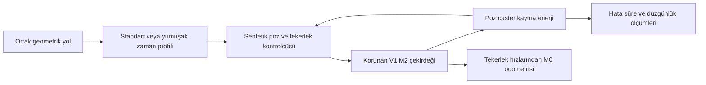

# Arche caster Python V2

**Güncel V2.3:** kontrol kazançları artık açık zaman sabiti/kutup hedeflerinden
hesaplanıyor; önceki kazançların baştan türetildiği iddia edilmiyor.
[Üç sayfalık İngilizce V2 kontrol hesabı](output/pdf/Arche_V2_Controller_Design_EN.pdf)
ve [tasarım hedefleri / kod eşlemesi](docs/controller-gain-design.md).
`controller_gains(parameters)` sonuçlarını doğrudan kontrolcü kullanır.
Önceki PDF ve deneyler tarihsel sürümlerine aittir.

**Güncel sürüm V2.2:** çalışma parametreleri artık bu klasörün `parameters/`
dizininden okunur. Her biri 0.4 kg dolu silindir kabulüyle tahrik spin ataleti
0.001125, caster roll ataleti 0.000320 kg m² olarak düzeltildi. V1/MATLAB eski
parametre ve sonuçları korunur. Caster yarıçap taramasında roll ataleti r² ile
değişir. [Atalet karşılaştırması](docs/inertia-alignment.md).

Güncel kısa hesap: [üç sayfalık İngilizce PDF](output/pdf/Arche_V2_Calculations_EN.pdf).
Aşağıdaki V2.1 sonuçları ve önceki Türkçe PDF'ler tarihsel sürüme aittir.

**Güncel sürüm V2.1:** tekerlek PI servosu ve terminal konum/açı kontrolüyle
takip düzeltildi. Önceki V2 kaynakları ve sonuçları korundu. Aynı 1 saniyelik
pencerede tamamlanma 3/16'dan 8/16'ya çıktı; 8 saniyelik terminal gözlemde
16/16 nominal ve duyarlılık dahil 40/40 koşu tamamlandı. Aynı pencereye ait
ölçümler de kaydediliyor; gözlem süresi ile kontrol etkisi ayrı raporlanıyor.

[Üç sayfalık V2 hesap eki](output/pdf/Arche_V2_Kisa_Hesap_TR.pdf),
[ayrıntılı türetim](output/pdf/Arche_V2_Matematiksel_Turetim_ve_Dogrulama_TR.pdf)
ve [kontrol düzeltmesi değerlendirmesi](docs/tracking-fix.md).

V2, mevcut M2 fizik çekirdeğini koruyarak onu proje araştırmasına bağlayan
yerel deney katmanıdır. V1 denklemleri değiştirilmedi. Bu sürüm; yörünge
takibi, profil karşılaştırması, caster duyarlılığı ve kayıt karşılaştırmasını
çalıştırır. Kalibre edilmiş fiziksel robot dijital ikizi henüz değildir.

## Başlamak

Terminalde:

```sh
cd caster-physics-python-v2  # from the repository root
../caster-physics-python/.venv/bin/python run_study.py --group core
```

Bu komut 16 koşuyu çalıştırır: iki sentetik zemin × dört manevra × iki profil.
Her koşunun CSV'si, üç panelli grafiği, tüm parametreleri, hata/enerji/süre
ölçümleri ve hash'leri yeni bir `outputs/study-.../` klasörüne yazılır.
`summary.md` okunabilir tabloyu, `study.json` ayrıntılı sonuçları içerir.
Mevcut sonuç klasörünün üzerine yazılmaz.

```sh
# Caster parametre taraması: 28 koşu, yalnız dönüş manevrası
../caster-physics-python/.venv/bin/python run_study.py --group design
# Temel matris + tekrarsız duyarlılık taraması: toplam 40 koşu
../caster-physics-python/.venv/bin/python run_study.py --group all
# V2 davranışları, bağımsız fizik özdeşlikleri ve kayıt sözleşmesi
../caster-physics-python/.venv/bin/python -m pytest -q tests
```

Yeni bağımlılık kurulmaz; V1'in NumPy/Matplotlib/Pytest ortamı kullanılır.
İki klasör yan yana tutulmalıdır. V2 açılışta V1 hash'lerini denetler;
değişmiş bir çekirdekle sessizce devam etmez.

## V1 ile V2 arasındaki fark

| | Korunan V1 | V2 |
| --- | --- | --- |
| Soru | Verilen tekerlek torklarında gövde ve caster nasıl hareket eder? | Bu mekanik model aynı yolu takip ederken profil, zemin ve caster değişimlerine nasıl tepki verir? |
| Girdi | Önceden tanımlanmış tork programı | Zamanlı yol referansı → takip/terminal kontrolü ve tekerlek PI → aks torkları |
| Model | Kuvvetlere bağlı düzlemsel M2 | Aynı M2 çekirdeği |
| Karşılaştırma | Kayıtlı MATLAB ve fizik kontrolleri | Standart/yumuşak profil, ideal tekerlek odometrisi, parametre duyarlılığı |
| Kanıt | Sayısal eşdeğerlik ve mekanik tutarlılık | Sentetik geliştirme deneyleri; bağımsız poz referansı varsa kayıt değerlendirmesi |



## Karşılaştırmayı nasıl okumalıyım?

Manevralar düz gidiş, sabit eğrilikli dönüş, ileri–geri ve S dönüşüdür.
Başlangıç caster açısı her koşuda 45°; başlangıç aks merkezi dünya (0,0)'dır.
Entegre edilen konum gövde COM'udur; raporlanan yol tahrik aksı merkezidir.
Poz kontrolcüsü modelin gerçek pozunu görür. Bu bir robot konum kestiricisi
veya sahada çalıştığı gösterilmiş motor sürücüsü değildir.

Standart profil segment boyunca sabit hız ister; başlangıç, bitiş ve segment
geçişlerinde hız sıçramaları vardır. Yumuşak profil her segmentte quintic
ilerleme kullanır: `s(u)=10u³−15u⁴+6u⁵`. Geometri aynıdır. Aynı tepe referans
hızını tutmak için yumuşak profil süresi 1.875 kat uzatılır. Bu, geliştirme
adayıdır; projedeki tek finalist henüz bağımsız deneylerle seçilmedi.

Her koşuda profil bittikten sonra sekiz saniyelik terminal gözlem vardır;
eski bir saniyelik penceredeki sonuç da ayrıca kaydedilir.
Tamamlama; profil bittikten sonra 2 cm konum, 0.05 rad açı, 0.02 m/s hız ve
0.05 rad/s yaw hızı sınırlarının 0.25 saniye tutulmasını gerektirir.
Hız artık boyuna ve yanal bileşenlerin normudur; kalış süresi örnek sayısıyla
değil zaman damgalarıyla ölçülür. `completion_time_s` doğrulanmış kalışın
başlangıcıdır; karar en erken 0.25 saniye sonra verilebilir.
Ulaşılamazsa süre `null` / `not reached` kalır. Ufuk sonunda her koşuyu
tamamlanmış saymayız. Bu toleranslar sentetik geliştirme ölçütleridir.

Zamana bağlı konum/yaw RMSE'si, ortak yola en yakın örneğe mesafe, tamamlanma,
100 Hz örneklerden tahmini jerk RMS, caster kayması/parazitik moment,
iş ve enerji dengesi ayrı ayrı raporlanır. Net motor işi işaretlidir;
batarya tüketimi değildir. Farklı süreli profillerin ortalamaları gözlem
penceresine bağlıdır; toplam süre ve hata eğrileriyle birlikte okunmalıdır.

İki zemin `reference_synthetic` ve `high_drag_synthetic` adındadır. Sayılar
mermer/halı/paver ölçümü değildir. İkinci koşul daha yüksek yuvarlanma
direnci ve farklı kayma/sürtünme katsayıları varsayar. Gerçek yüzey adlarına
evrensel katsayı atanmamıştır.

Caster taraması trail 30/50/70 mm, yarıçap 30/40/50 mm ve swivel viskoz
sönümünün yarısı/iki katını karşılaştırır. Her seferinde tek parametre
değişir. Kütle sabit kalır; V2.2'de yarıçapla birlikte roll ataleti r² ile
ölçeklenir, diğer ataletler sabittir. Bunlar **kısmi duyarlılık deneyleri**;
satın alınabilir bir caster seçiminin fiziksel karşılaştırması değildir.
Gerçek malzeme/durometre için temas ve direnç ölçümleri gerekir.

M0, aynı ölçülen/simüle edilen tekerlek hızlarından ideal kaymasız aks
odometrisini üretir. M2'yi sentetik doğru kabul edip M0'a karşı üstünlük
kanıtlamayız. Kayıt değerlendiricisinde M0 tekerlek hızlarını, M2 aks
torklarını alır; bu farklı girdi kanallarıyla yapılan tanısal karşılaştırma
caster etkisini tek başına izole etmez. RQ1 için ortak komut kayıtları,
kalibre edilmiş tahrik/servo modeli ve bağımsız fiziksel poz gerekir.

## Gerçek kayıtla karşılaştırma

`evaluate_recording.py`, zaman damgalı **gerçek aks torklarını** M2'ye yeniden
uygular. Voltajı, motor akımını veya `cmd_vel` değerini tork kabul etmez.
Bağımsız poz referansı ile M0 tekerlek odometrisini ve M2 tahminini ayrı
karşılaştırır. Kayıt girdileri için [sözleşmeye](docs/recording-contract.md) bak.

```sh
../caster-physics-python/.venv/bin/python evaluate_recording.py \
  /absolute/path/run.csv /absolute/path/run-metadata.json --name recording-run-001
```

Robot yalnız hız komutu sunuyorsa bu tork tekrar yolu kullanılamaz.
Önce robotun tahrik/servo davranışı ölçülüp modellenmeli veya hız arayüzü
olan simülasyon karşılığı kurulmalıdır. Bu eksiklik sahte torkla doldurulmaz.

## Koruma ve doğrulama

- `../caster-physics-python/`: özgün V1, kaynakları değiştirilmedi.
- `evidence/v1_sha256.json`: V1 kaynak ve referanslarının 52 özgün SHA-256 özeti.
- `evidence/v1-verification-report.json`: 13 Kasım yeniden çalıştırılan
  MATLAB karşılaştırması ve fizik kontrolleri.
- [Kapsam ve doğrulama değerlendirmesi](docs/validation-and-scope.md).
- [İş durumu](docs/implementation-status.md).

Bu V2 klasörü tek başına taşınabilir bir wheel paketi değildir.

ROS 2/Gazebo/Isaac kurulmadı, 3B temas/eğim/lastik shimmy modellenmedi.
Bu arayüzler ve gerçek kalibrasyon, platform bilgisi ve deney erişimiyle
tamamlanacak sonraki proje aşamalarıdır. GitHub'a yayın yapılmadı.
