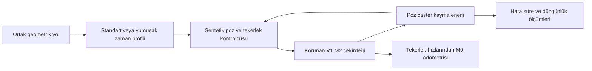

# Arche caster Python V2

**Güncel V2.3:** kontrol kazançları artık açık zaman sabiti/kutup hedeflerinden
hesaplanıyor; önceki kazançların baştan türetildiği iddia edilmiyor.
[Üç sayfalık İngilizce V2 kontrol hesabı](output/pdf/Arche_V2_Controller_Design_EN.pdf)
ve [tasarım hedefleri / kod eşlemesi](docs/controller-gain-design.md).
`controller_gains(parameters)` sonuçlarını doğrudan kontrolcü kullanır.
Önceki PDF ve deneyler tarihsel sürümlerine aittir.

**Güncel sürüm V2.2:** çalışma parametreleri artık bu klasörün `parameters/`
dizininden okunur. Her biri 0.4 kg dolu silindir kabulüyle tahrik spin ataleti
0.001125, caster roll ataleti 0.000320 kg m² olarak düzeltildi. V1/MATLAB eski
parametre ve sonuçları korunur. Caster yarıçap taramasında roll ataleti r² ile
değişir. [Atalet karşılaştırması](docs/inertia-alignment.md).

Güncel kısa hesap: [üç sayfalık İngilizce PDF](output/pdf/Arche_V2_Calculations_EN.pdf).
Aşağıdaki V2.1 sonuçları ve önceki Türkçe PDF'ler tarihsel sürüme aittir.

**Güncel sürüm V2.1:** tekerlek PI servosu ve terminal konum/açı kontrolüyle
takip düzeltildi. Önceki V2 kaynakları ve sonuçları korundu. Aynı 1 saniyelik
pencerede tamamlanma 3/16'dan 8/16'ya çıktı; 8 saniyelik terminal gözlemde
16/16 nominal ve duyarlılık dahil 40/40 koşu tamamlandı. Aynı pencereye ait
ölçümler de kaydediliyor; gözlem süresi ile kontrol etkisi ayrı raporlanıyor.

[Üç sayfalık V2 hesap eki](output/pdf/Arche_V2_Kisa_Hesap_TR.pdf),
[ayrıntılı türetim](output/pdf/Arche_V2_Matematiksel_Turetim_ve_Dogrulama_TR.pdf)
ve [kontrol düzeltmesi değerlendirmesi](docs/tracking-fix.md).

V2, mevcut M2 fizik çekirdeğini koruyarak onu proje araştırmasına bağlayan
yerel deney katmanıdır. V1 denklemleri değiştirilmedi. Bu sürüm; yörünge
takibi, profil karşılaştırması, caster duyarlılığı ve kayıt karşılaştırmasını
çalıştırır. Kalibre edilmiş fiziksel robot dijital ikizi henüz değildir.

## Başlamak

Terminalde:

```sh
cd caster-physics-python-v2  # from the repository root
../caster-physics-python/.venv/bin/python run_study.py --group core
```

Bu komut 16 koşuyu çalıştırır: iki sentetik zemin × dört manevra × iki profil.
Her koşunun CSV'si, üç panelli grafiği, tüm parametreleri, hata/enerji/süre
ölçümleri ve hash'leri yeni bir `outputs/study-.../` klasörüne yazılır.
`summary.md` okunabilir tabloyu, `study.json` ayrıntılı sonuçları içerir.
Mevcut sonuç klasörünün üzerine yazılmaz.

```sh
# Caster parametre taraması: 28 koşu, yalnız dönüş manevrası
../caster-physics-python/.venv/bin/python run_study.py --group design
# Temel matris + tekrarsız duyarlılık taraması: toplam 40 koşu
../caster-physics-python/.venv/bin/python run_study.py --group all
# V2 davranışları, bağımsız fizik özdeşlikleri ve kayıt sözleşmesi
../caster-physics-python/.venv/bin/python -m pytest -q tests
```

Yeni bağımlılık kurulmaz; V1'in NumPy/Matplotlib/Pytest ortamı kullanılır.
İki klasör yan yana tutulmalıdır. V2 açılışta V1 hash'lerini denetler;
değişmiş bir çekirdekle sessizce devam etmez.

## V1 ile V2 arasındaki fark

| | Korunan V1 | V2 |
| --- | --- | --- |
| Soru | Verilen tekerlek torklarında gövde ve caster nasıl hareket eder? | Bu mekanik model aynı yolu takip ederken profil, zemin ve caster değişimlerine nasıl tepki verir? |
| Girdi | Önceden tanımlanmış tork programı | Zamanlı yol referansı → takip/terminal kontrolü ve tekerlek PI → aks torkları |
| Model | Kuvvetlere bağlı düzlemsel M2 | Aynı M2 çekirdeği |
| Karşılaştırma | Kayıtlı MATLAB ve fizik kontrolleri | Standart/yumuşak profil, ideal tekerlek odometrisi, parametre duyarlılığı |
| Kanıt | Sayısal eşdeğerlik ve mekanik tutarlılık | Sentetik geliştirme deneyleri; bağımsız poz referansı varsa kayıt değerlendirmesi |



## Karşılaştırmayı nasıl okumalıyım?

Manevralar düz gidiş, sabit eğrilikli dönüş, ileri–geri ve S dönüşüdür.
Başlangıç caster açısı her koşuda 45°; başlangıç aks merkezi dünya (0,0)'dır.
Entegre edilen konum gövde COM'udur; raporlanan yol tahrik aksı merkezidir.
Poz kontrolcüsü modelin gerçek pozunu görür. Bu bir robot konum kestiricisi
veya sahada çalıştığı gösterilmiş motor sürücüsü değildir.

Standart profil segment boyunca sabit hız ister; başlangıç, bitiş ve segment
geçişlerinde hız sıçramaları vardır. Yumuşak profil her segmentte quintic
ilerleme kullanır: `s(u)=10u³−15u⁴+6u⁵`. Geometri aynıdır. Aynı tepe referans
hızını tutmak için yumuşak profil süresi 1.875 kat uzatılır. Bu, geliştirme
adayıdır; projedeki tek finalist henüz bağımsız deneylerle seçilmedi.

Her koşuda profil bittikten sonra sekiz saniyelik terminal gözlem vardır;
eski bir saniyelik penceredeki sonuç da ayrıca kaydedilir.
Tamamlama; profil bittikten sonra 2 cm konum, 0.05 rad açı, 0.02 m/s hız ve
0.05 rad/s yaw hızı sınırlarının 0.25 saniye tutulmasını gerektirir.
Hız artık boyuna ve yanal bileşenlerin normudur; kalış süresi örnek sayısıyla
değil zaman damgalarıyla ölçülür. `completion_time_s` doğrulanmış kalışın
başlangıcıdır; karar en erken 0.25 saniye sonra verilebilir.
Ulaşılamazsa süre `null` / `not reached` kalır. Ufuk sonunda her koşuyu
tamamlanmış saymayız. Bu toleranslar sentetik geliştirme ölçütleridir.

Zamana bağlı konum/yaw RMSE'si, ortak yola en yakın örneğe mesafe, tamamlanma,
100 Hz örneklerden tahmini jerk RMS, caster kayması/parazitik moment,
iş ve enerji dengesi ayrı ayrı raporlanır. Net motor işi işaretlidir;
batarya tüketimi değildir. Farklı süreli profillerin ortalamaları gözlem
penceresine bağlıdır; toplam süre ve hata eğrileriyle birlikte okunmalıdır.

İki zemin `reference_synthetic` ve `high_drag_synthetic` adındadır. Sayılar
mermer/halı/paver ölçümü değildir. İkinci koşul daha yüksek yuvarlanma
direnci ve farklı kayma/sürtünme katsayıları varsayar. Gerçek yüzey adlarına
evrensel katsayı atanmamıştır.

Caster taraması trail 30/50/70 mm, yarıçap 30/40/50 mm ve swivel viskoz
sönümünün yarısı/iki katını karşılaştırır. Her seferinde tek parametre
değişir. Kütle sabit kalır; V2.2'de yarıçapla birlikte roll ataleti r² ile
ölçeklenir, diğer ataletler sabittir. Bunlar **kısmi duyarlılık deneyleri**;
satın alınabilir bir caster seçiminin fiziksel karşılaştırması değildir.
Gerçek malzeme/durometre için temas ve direnç ölçümleri gerekir.

M0, aynı ölçülen/simüle edilen tekerlek hızlarından ideal kaymasız aks
odometrisini üretir. M2'yi sentetik doğru kabul edip M0'a karşı üstünlük
kanıtlamayız. Kayıt değerlendiricisinde M0 tekerlek hızlarını, M2 aks
torklarını alır; bu farklı girdi kanallarıyla yapılan tanısal karşılaştırma
caster etkisini tek başına izole etmez. RQ1 için ortak komut kayıtları,
kalibre edilmiş tahrik/servo modeli ve bağımsız fiziksel poz gerekir.

## Gerçek kayıtla karşılaştırma

`evaluate_recording.py`, zaman damgalı **gerçek aks torklarını** M2'ye yeniden
uygular. Voltajı, motor akımını veya `cmd_vel` değerini tork kabul etmez.
Bağımsız poz referansı ile M0 tekerlek odometrisini ve M2 tahminini ayrı
karşılaştırır. Kayıt girdileri için [sözleşmeye](docs/recording-contract.md) bak.

```sh
../caster-physics-python/.venv/bin/python evaluate_recording.py \
  /absolute/path/run.csv /absolute/path/run-metadata.json --name recording-run-001
```

Robot yalnız hız komutu sunuyorsa bu tork tekrar yolu kullanılamaz.
Önce robotun tahrik/servo davranışı ölçülüp modellenmeli veya hız arayüzü
olan simülasyon karşılığı kurulmalıdır. Bu eksiklik sahte torkla doldurulmaz.

## Koruma ve doğrulama

- `../caster-physics-python/`: özgün V1, kaynakları değiştirilmedi.
- `evidence/v1_sha256.json`: V1 kaynak ve referanslarının 52 özgün SHA-256 özeti.
- `evidence/v1-verification-report.json`: 13 Kasım yeniden çalıştırılan
  MATLAB karşılaştırması ve fizik kontrolleri.
- [Kapsam ve doğrulama değerlendirmesi](docs/validation-and-scope.md).
- [İş durumu](docs/implementation-status.md).

Bu V2 klasörü tek başına taşınabilir bir wheel paketi değildir.

ROS 2/Gazebo/Isaac kurulmadı, 3B temas/eğim/lastik shimmy modellenmedi.
Bu arayüzler ve gerçek kalibrasyon, platform bilgisi ve deney erişimiyle
tamamlanacak sonraki proje aşamalarıdır. GitHub'a yayın yapılmadı.

## JANUS scenarios

JANUS uses the same V2.3 parameters, fixed-step V1 M2 plant and bounded wheel
PI as the legacy study. The task layer adds timestamped route gates, signed
QR centering and safety interlocks. Inspect cases with `python run_janus.py
--help`. The legacy `run_study.py --group core` interface is unchanged.

From the JANUS Python lane root on the mounted SSD:

```sh
source env.sh
cd checkout/caster-physics-python-v2
../../.venv/bin/python run_study.py --case M04 M05 M06 Q02 Q03 Q06 \
  --output-dir ../../outputs/runs/example --jobs 4
../../.venv/bin/python -m pytest -q -p no:cacheprovider tests
```

`--group p0` runs the approved P0 list, `--group additional` runs P1 variants,
and `--group all --output-dir NEW_DIRECTORY` runs the full configured Python
catalog. `--variant` selects one variant. `--publish-commands DIRECTORY` exports
replay inputs with their initial state and provenance per run. Use a fresh replay
directory for a repeat. Cases can end in an expected safe abort and pass a
scenario check. A failed scenario check remains in the index and metrics.

M07 `narrow-replanned` retains the fixed narrow walls and conservative robot
footprint. Its four 0.30 m straights use 0.06 m tangent corner radii and 2.8 s /
2.4 s straight and arc periods. The initial axle pose is offset by
(+0.0484, −0.0080) m within the same wall frame. The `rounded` and
`wider-envelope` variants retain their original reference.

```sh
python run_janus.py --case M07 --variant narrow-replanned --output-dir NEW_DIRECTORY
```

- `commands.csv` holds the requested body twist, `executed_velocity.csv` holds
  the limited twist sent to the wheel PI, and `applied_torque.csv` is the sampled
  axle torque held ZOH through the solver stages. Actual axle velocity/yaw,
  effort, caster and slip measurements are in `results.csv`.
- Route, square and dock thresholds, event schedules, source hashes and exact
  rerun arguments are in the manifest, config, scenario and metrics JSON.
  Each run includes an overview figure and interactive offline motion HTML.
- The 20 Hz QR fixture projects the physical marker corners from each current
  axle pose, and the controller samples the latest valid arrival at 100 Hz.
  The diagonal intersection gives the marker's physical center in the image.
  Range uses the vertical-edge heights with a level pinhole camera. A second
  undecoded candidate makes a frame with the expected ID ambiguous.
- Q05 allows yaw-only search on fresh empty frames within 3.2 s for the one-way
  variant or 5.2 s for the sweep. It checks bounded search, fresh target
  acquisition and safe stopping independently. The one-way control can stop
  safely and still fail acquisition.
- Virtual contact requires 0.25 s continuously within 0.02 m, 3°, 0.02 m/s and
  0.05 rad/s. The settle window after the range stop is 1.5 s. Pose and speed
  must stay inside those limits through confirmation by a fresh post-contact
  virtual BMS event. Loss of hold aborts the attempt.
- O04 `stream-watchdog` and `stream-operator` drive the shared command guard
  before measuring the planar stop. O05 `guard-odometry-cut` and
  `guard-odometry-rewind` record delivered and accepted odometry stamps, the
  guard's rejection reason and post-cut braking. The original injected-stop
  runs are preserved. These fixtures use synthetic clocks and inputs.
- Q13 `regressive-capture` delivers a still-fresh backward capture stamp and
  checks inhibition at its first control sample. Separate Q13 variants cover
  repeated stamps, latency and loss of the camera stream.
- Q04 `staged-lateral` estimates a preparation pose from the projected QR
  corners. The sampled steering and forward request both cut if the marker is
  lost during staging. The camera centering dwell and virtual contact checks
  follow the staging pose gates.
- M11 `brake-reference`, `brake-high-drag` and `brake-boundary` log the actual
  brake step and the later measured stop dwell. The boundary variant crosses
  the configured surface edge before the brake command.
- The optional OpenCV PNG decoder exercise has its own evidence scope and can be
  run with `python janus_decode.py --output-dir NEW_DIRECTORY`. It decodes static
  generated images. The projection controller's timing and optics are distinct.
- `verify_janus.py --help` gives the audit interface. It checks shared CSV copies
  and independently recomputes gating conditions. Selected constant-surface
  runs can be fed back through the legacy `evaluate_recording.py` evaluator for
  same-plant numerical replay.
