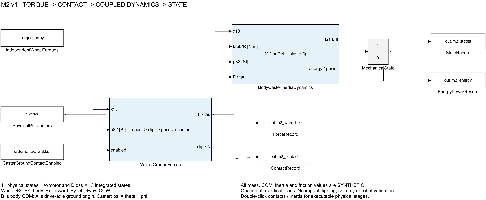

# M2 v1 — executable contact and inertia stages

Native Windows MATLAB R2026b ran twelve scenarios: **60/60 physical and numerical checks** and **13/13 workflow checks** passed, both batch exits 0. The full verifier includes the kernel checks; the separate kernel run passed 17/17. See [executed summary](executed_summary.json), [physics evidence](verification_evidence.json), [workflow evidence](workflow_verification_evidence.json) and the captured transcripts.

The original M0 and M2 v0 files remain unchanged: 115 file hashes matched the preservation snapshot. All twelve default result CSVs are byte-identical to M2 v0. This revision fixes source lookup for direct SLX opening, separates command/result sampling and preserves an open user model through an isolated replay. It exposes support loads, slip, friction, generalized forces, coupled inertia and energy accounting as executable Simulink stages. It does not change the physical equations or synthetic parameters.

Keep this whole folder together. From the package root in MATLAB:

```matlab
open_system(fullfile('models','Me492CasterM2V1.slx'));
run_m2('aligned_forward');
run_m2('misaligned_forward');
% Generate a complete new run before full verification:
run_m2;
verify_m2;
export_m2_results;
```

Direct Run uses saved Model Workspace values; `run_m2` reloads the named JSON parameters. Save manual edits before replay. `verify_workflow` belongs in a separate MATLAB batch session; it tests model-opening/preservation behaviour using isolated copies. See the detailed [Turkish walkthrough](README_Turkce.md), [equations](theory.md) and [SI/state schema](schema.md).

This transferred review package contains three representative result CSVs and five native figures. Full execution generated twelve result CSVs and twelve command CSVs on Windows. Run `run_m2` before `verify_m2` to regenerate the complete set locally; the manifest intentionally references files outside this bounded review package. `models/Me492CasterM2.slx` is the preserved builder input; `Me492CasterM2V1.slx` is the revised model.

The Mac verified ZIP CRC and all 49 selected-member SHA-256 hashes against the Windows manifest. MATLAB was executed on Windows, not on this Mac. The immutable delivered ZIP has SHA-256 `fe10254e4ed8efa44307513fca1e299d4694db0d292d020e2172a54f70dc3db9`.

The model remains a synthetic planar torque-driven baseline with a passive caster. Normal loads are quasi-static; there is no measured robot calibration, 3D impact/tipping, compliant tyre shimmy or motor electrical/speed-control model. Numerical consistency is separate from physical robot validation.


